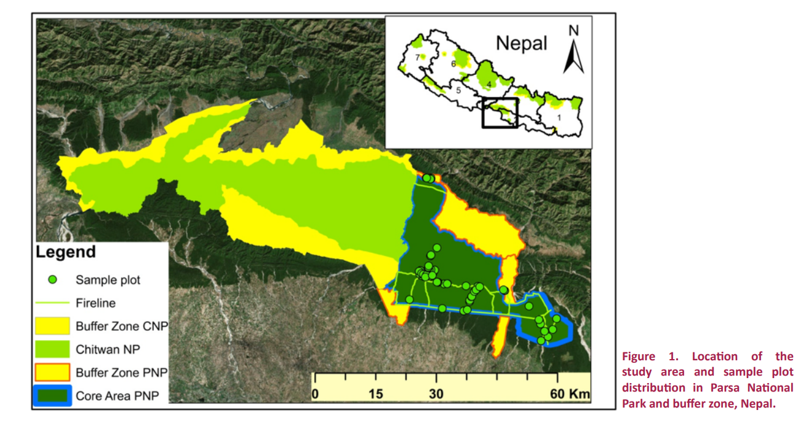

# Mapping Asian Elephant Habitat Suitability in Parsa National Park, Nepal

Published research case study combining field surveys, GIS environmental layers, and boosted regression trees to map Asian elephant habitat suitability.

## Project overview

For my undergraduate research, I conducted vegetation surveys in Parsa National Park and its buffer zone and combined field observations with environmental spatial data to model Asian elephant habitat suitability.

The study was published in the *Journal of Threatened Taxa* in 2019.

## My contribution

- Conducted fieldwork and plot-based vegetation surveys.
- Recorded tree measurements, species composition, canopy cover, and regeneration.
- Worked with GPS observations and environmental raster layers.
- Used boosted regression trees in R to model habitat suitability.
- Served as first author of the publication.

## Research question

How does predicted elephant habitat suitability vary across Parsa National Park and its buffer zone?

## Study area and sampling

*Figure 1 from Sharma et al. (2019): location of the study area and sample plots in Parsa National Park and its buffer zone, Nepal.*

## Data and methods

The research combined elephant presence/absence observations, field-measured habitat variables, and topographic and climate predictors derived from JAXA and WorldClim data.

GIS supported spatial data preparation and mapping. Boosted regression trees in R were used to model habitat suitability.

The landscape prediction shown below uses altitude, slope, aspect, precipitation, and temperature. Other field-measured predictors were not available across the entire landscape and therefore were not included in this mapped prediction.

See the publication for detailed sampling methods, data sources, predictor variables, and model settings.

*Appendix 5 from Sharma et al. (2019): elephant distribution prediction based on altitude, slope, aspect, precipitation, and temperature using a boosted regression tree model.*

The map shows model predictions alongside recorded presence and absence observations. It does not confirm elephant presence at every location.

The background imagery provides geographic context and should be distinguished from the environmental raster layers used as model predictors.

## GIS skills demonstrated

- Integration of GPS field observations and environmental spatial data
- Use of topographic and climate raster predictors
- Spatial analysis supporting habitat suitability modeling
- Map preparation and communication of spatial predictions

## Interpretation and limitations

Predictions depend on the sampling design, available observations, environmental predictors, and model assumptions.

The mapped prediction uses only predictors available across the landscape. It does not include every habitat variable assessed during fieldwork.

The apparent detail of the map should not be interpreted as equivalent detail in the underlying environmental data. Resampling a raster to smaller cells does not add new environmental information.

## Repository contents

- `study-area-and-sampling.png` — published study-area and sampling map
- `elephant-suitability-prediction.png` — published spatial prediction from Appendix 5
- `README.md` — project background, contributions, methods, and limitations

This repository presents a published research case study. It does not currently contain the original data and code needed to reproduce the analysis.

## Publication

Sharma, P., Adhikari, H., Tripathi, S., Ram, A. K., & Bhattarai, R. (2019).
Habitat suitability modeling of Asian elephant *Elephas maximus*
(Mammalia: Proboscidea: Elephantidae) in Parsa National Park, Nepal
and its buffer zone. *Journal of Threatened Taxa, 11*(13), 14643–14654.

https://doi.org/10.11609/jott.4467.11.13.14643-14654
